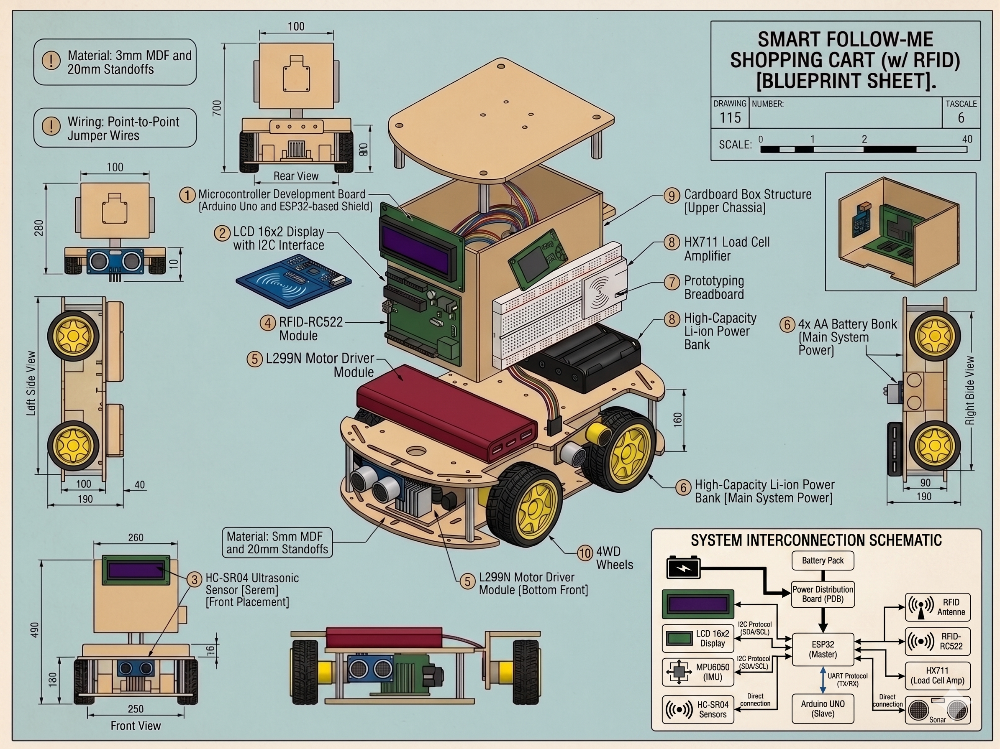
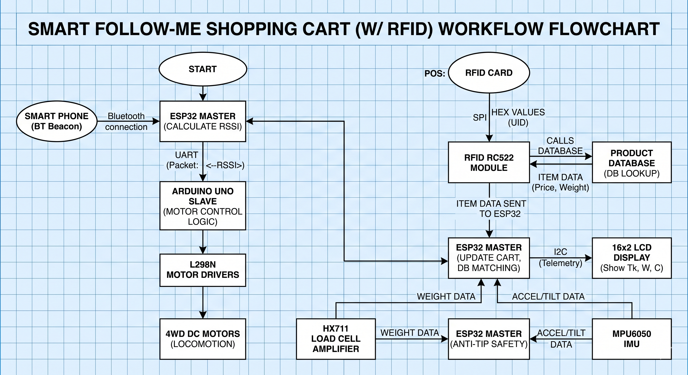
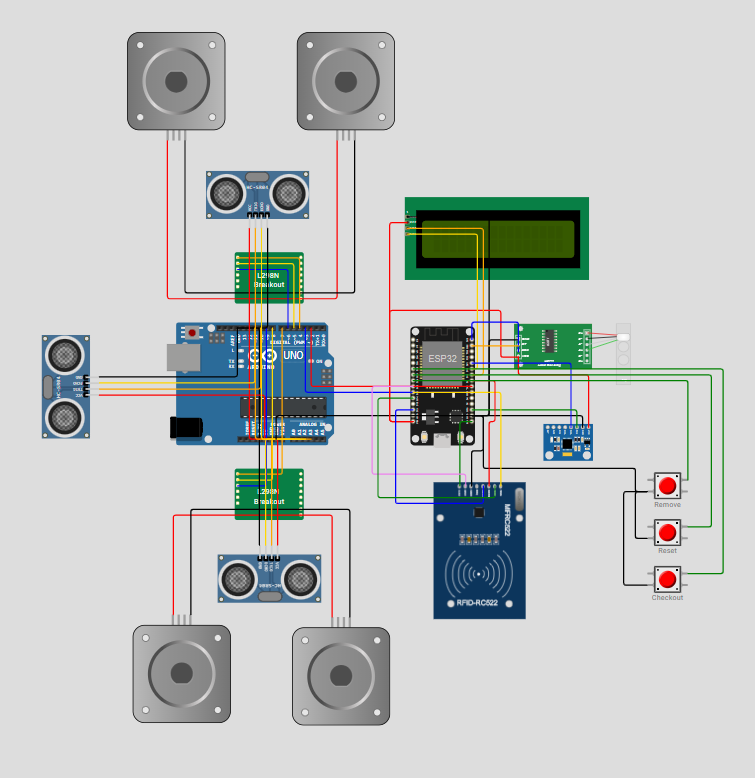

# 🛒 Smart Follow-Me Shopping Cart (w/ RFID)

---

## 🎯 Purpose

**Objective:**
Design and build an autonomous shopping cart robot that locks onto a specific user, follows them safely utilizing a dual-microcontroller architecture, intelligently avoids obstacles, and provides an integrated RFID self-checkout system that monitors real-time cost and weight.

**Scope:**
Small-to-medium retail stores, libraries, and warehouses offering a localized, low-cost autonomous solution.

**Significance:**
Eradicates the physical burden of pulling a cart, eliminates long checkout lines, and fosters accessibility for physically impaired and elderly shoppers.

---

## ⚙️ Components

### Microcontrollers

- ESP32 DevKit (Master - High-Level Logic)
- Arduino UNO R3 (Slave - Low-Level Locomotion)

### Sensors

- 4x Ultrasonic sensor HC-SR04
- 1x IMU MPU6050
- 1x RFID reader RC522
- 1x Load cell (10 kg)

### Actuators

- 1x DC Gear Motors (4WD) Chassis
- 2x L298N Motor Driver

### Power & Additional Components

- 1x HX711 amplifier
- 1x LCD 16x2 with I2C module
- 3x Buttons
- 1x Battery case 4xAA
- 4x Battery 3.7V (Wired in series for 14.8V)
- 1x Power Distribution Board (12V & 5V step-down)
- Resistors (for UART Voltage Divider)
- 1x Smart Phone (BLE Beacon)
- 5x RFID NFC Smart Card

---

## 💰 Cost Breakdown (Approx.)

| Component                    | Qty | Unit Cost (BDT) | Total (BDT) |
| :--------------------------- | :-- | :-------------- | :---------- |
| Arduino UNO R3               | 1   | 480             | 480         |
| ESP32 DevKit                 | 1   | 420             | 420         |
| Smart Phone                  | 1   | 0               | 0           |
| L298N Motor Driver           | 2   | 120             | 240         |
| DC Gear Motors (4WD) Chassis | 1   | 750             | 750         |
| Ultrasonic Sensor HC‑SR04    | 4   | 60              | 240         |
| MPU6050                      | 1   | 160             | 160         |
| RFID Reader RC522            | 1   | 110             | 110         |
| RFID NFC Smart Card          | 5   | 25              | 125         |
| Load cell (10 kg) + HX711    | 1   | 220             | 220         |
| LCD 16x2 with I2C module     | 1   | 195             | 195         |
| Buttons                      | 3   | 2               | 5           |
| Battery case 4xAA            | 1   | 45              | 45          |
| Battery 3.7V                 | 4   | 95              | 380         |
| Power Distribution Board     | 1   | 330             | 330         |
| Jumper Wires (M-M, M-F, F-F) | 3   | 65              | 195         |
| Resistors                    | 1   | 50              | 50          |
| Breadboards (Small)          | 2   | 60              | 120         |
| Soldering Iron               | 1   | 495             | 495         |
| Soldering Wire               | 1   | 210             | 210         |
| Soldering Rosin              | 1   | 20              | 20          |
| Soldering Stand              | 1   | 110             | 110         |
| **Grand Total**              |     |                 | **4900**    |

---

## 🚀 Functionality Breakdown

### Functionality 1: User Lock-On + Proportional Auto Follow

**Overview:** The cart tracks the user's smartphone via Bluetooth Low Energy (BLE) and dynamically adjusts its speed to stay within an optimal "Sweet Spot" distance.

**Working Procedure:**

- **Pairing / Lock-on:**
  - The ESP32 utilizes a custom BLE callback to actively scan for a target smartphone broadcasting as "CART_REMOTE".
- **Follow Logic:**
  - The ESP32 calculates the Received Signal Strength Indicator (RSSI) to determine proximity.
  - A tracking "Sweet Spot" is maintained between -50 dBm and -85 dBm.
  - The ESP32 packages the RSSI value into framed data packets (e.g., `<-75>`) and transmits them at 10Hz over a safe logic-level shifted UART bridge to the Arduino UNO.
- **Motion Execution:**
  - The Arduino UNO maps the received signal strength to a proportional hardware PWM speed (pins D5, D9).
  - It accelerates when the user pulls away and slows down as they stop, directing power through dual L298N motor drivers to the 4WD chassis.

### Functionality 2: Subsumption Obstacle Avoidance + Safety Braking

**Overview:** A dedicated hardware coprocessor handles real-time collision avoidance and emergency failsafes to protect the system and users.

**Working Procedure:**

- **Obstacle Sensing (Subsumption Logic):**
  - The Arduino UNO continuously polls the front and side HC-SR04 ultrasonic sensors.
  - If a frontal obstacle breaches the 30cm threshold, the UNO overwrites the ESP32's tracking command and executes a hard stop.
  - If a side obstacle breaches the 20cm threshold, it performs a "Soft Nudge" by reducing PWM power to one side, drifting away from the wall.
  - A software filter validates obstacles by ignoring false-positive "ghost echoes" (spikes of 0cm/999cm).
- **Safety Braking & Failsafes:**
  - **Deadman's Switch:** If the UNO does not receive a UART packet from the ESP32 within 1000ms, it assumes a communication drop and locks the motors.
  - **Anti-Tip Safety:** The MPU6050 monitors pitch and roll. If tilt exceeds 35° on the X or Y-axis, the ESP32 transmits a -100 (Lock) signal to immediately stop the cart.

### Functionality 3: Interactive POS (Point of Sale) & Verification

**Overview:** The cart features an integrated self-checkout system utilizing RFID tagging, digital telemetry, and load cell weight verification.

**Working Procedure:**

- **Item Scanning:**
  - When a user touches an NFC product tag to the RC522 reader (using a dedicated high-speed SPI bus), the ESP32 temporarily halts all motor tracking to ensure a stable transaction.
  - The ESP32 queries the local database to retrieve the item's price and expected weight.
- **Weight Measurement:**
  - The HX711 amplifier reads the physical weight placed in the cart via the 10kg load cell.
  - This ensures the physical payload matches the digital database entry for theft prevention.
- **LCD UI (16x2 I2C):**
  - The ESP32 heavily multiplexes its pins to update the I2C LCD.
  - It displays the newly updated item count and the total financial value (Tk) in real-time.
- **Buttons Interface:**
  - Three physical buttons are utilized for Remove, Reset, and Checkout functions, halting the robot instantly when pressed.

---

## 🔌 Hardware Integration & Schematics

- **Power Domains:** To prevent high-current motor noise from resetting the logic boards, the system uses separated power domains. The 14.8V battery pack is routed into a Power Distribution Board (PDB) which steps the voltage down to 12V for the L298N drivers and 5V for the microcontrollers and sensors.
- **Logic Level Shifting:** A voltage divider network using 3 resistors successfully steps down the Arduino UNO's 5V TX signal to the 3.3V logic limit of the ESP32's RX pin, preventing hardware damage during UART communication.

---

## 🧑‍💻 Team

| Name                          | ID       | Core Role & Responsibilities                                                                                                                                                                                         |
| ----------------------------- | -------- | -------------------------------------------------------------------------------------------------------------------------------------------------------------------------------------------------------------------- |
| Mohammad Jabir Safa Khandoker | 22201108 | Project Lead & Core Developer: Authored all C++ firmware for both ESP32 and Arduino UNO. Implemented the UART Master-Slave architecture, managed component procurement, and handled primary PCB/component soldering. |
| Fariha Tanha                  | 22101296 | Co-Integrator & BLE Dev: Developed the autonomous Bluetooth tracking system, implemented I2C communication (LCD and MPU6050), and manually crafted the custom cart chassis.                                          |
| Aarya Ibteda Foyez            | 22201509 | RFID & POS Integrator: Engineered the weight-verifying RFID scanner, normalized raw RFID bytes into consistent Hex strings, and developed the automated validation/billing logic on the ESP32.                       |
| Mugdha Farheen Kibria         | 22299206 | Sensor Logic Developer: Configured the HC-SR04 ultrasonic array and programmed the data filters to prevent erratic braking. Calibrated the 10kg load cell (HX711) and handled hardware troubleshooting.              |
| Safwan Masud                  | 23101425 | Mechanical Assembly: Assembled the 4WD structural frame, aligned the DC gear motors and wheels, wired the dual L298N driver modules, and assisted with secondary component procurement.                              |
